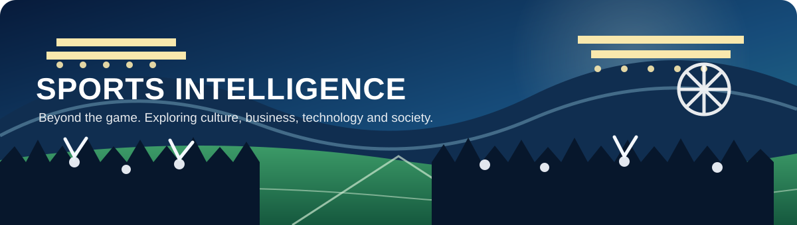

# Sports Intelligence

  

**We don't just watch sports. We investigate what sports reveal about people, culture, business and society.**  
**我们不只是观看体育，更希望通过体育理解人、文化、商业与社会。**

[English](#english) | [简体中文](#简体中文)

---

## English

Sports Intelligence is an open, community-led project exploring sport as more than competition. We look at the cultural, social, economic, commercial, technological and tourism dimensions of sports around the world.

This is a place to ask questions, exchange perspectives, share evidence and develop ideas together. You do not need to be a professional researcher, analyst or developer to participate.

### What we explore

Our work is interdisciplinary and open to different perspectives.

- **Sports & Culture** — fandom, identity, rituals, national culture and collective experiences.
- **Sports & Entertainment** — live events, performance, cheer culture, music, celebrities and social media.
- **Sports & Business** — leagues, teams, sponsorship, media rights, marketing and business models.
- **Sports & Society** — communities, inclusion, gender, social behaviour and public life.
- **Sports & Tourism** — sports events, stadium visits, destination experiences and travel motivation.
- **Sports & Technology** — AI, digital platforms, data, broadcasting and changing fan experiences.
- **Sports Performance & Analytics** — teams, athletes, tactics, performance data and competitive trends.

These areas overlap. A single topic may belong to several of them.

### How to participate

You can contribute in whatever way suits you:

1. **Start with a question.** Suggest something about sports that you are curious about.
2. **Join a discussion.** Share observations, experiences, opinions and different interpretations.
3. **Bring useful material.** Share articles, academic research, public datasets, reports or case examples, with sources where possible.
4. **Explore it together.** Compare countries, leagues, sports, audiences or business models. Look for evidence and alternative explanations.
5. **Help document what we learn.** Turn discussions into case studies, research briefs, datasets, visualisations or articles.

You can participate in conversations without using GitHub or writing code. GitHub is where we organise and preserve the work; it is not a requirement for taking part.

### Current research focus

#### Beyond the Game: Why Do People Go to KBO Stadiums?

  

Our first proposed exploration looks at the spectator experience around Korean professional baseball (KBO).

Possible questions include:

- Are spectators primarily attending for the game, or for a broader entertainment and social experience?
- How do organised cheering, music, performance and crowd participation shape the stadium atmosphere?
- What roles do food, socialising, identity and shared rituals play in the live experience?
- How might the KBO experience compare with NPB, MLB and other professional leagues?
- How do social media and digital content extend the stadium experience beyond the venue?

This is an open inquiry, not a conclusion. We welcome different viewpoints, relevant evidence and alternative questions.

See [the KBO topic brief](research-topics/kbo-stadium-experience.md).

#### Sports Collectibles: From Random Packs to Athlete IP

A second exploration examines how randomized pack openings, scarcity, collecting, PSA grading, athlete image and secondary-market exchange shape sports-card engagement. It also considers whether athlete aesthetics and lifestyle appeal can attract audiences beyond traditional sports fans.

Read the [Sports Collectibles & Athlete IP research brief](research-topics/sports-collectibles-and-athlete-ip.md).

### What we may produce

Depending on the question and the people involved, collaborative work may result in:

- Research briefs and literature notes
- Sports and industry case studies
- Cross-country or cross-league comparisons
- Data explorations and visualisations
- Interviews, field observations or fan-experience studies
- Articles, presentations and practical insights

Not every discussion needs to become a formal research project.

### Community principles

- Stay curious and open to different interpretations.
- Distinguish personal experience, opinion and evidence.
- Credit original sources and contributors.
- Be respectful when discussing teams, athletes, fans and cultures.
- Make participation accessible to people with different backgrounds and skill levels.
- Treat findings as provisional when evidence is limited.

Please read our [Contribution Guide](CONTRIBUTING.md) and [Code of Conduct](CODE_OF_CONDUCT.md).

### Get involved

Have a question, case, dataset, article or idea?

- Open a [GitHub Issue](https://github.com/kkkkkkkaro-cyber/sports-intelligence/issues) to propose a topic or start a research question.
- Join an existing discussion and add your perspective.
- Suggest an improvement to a research brief.
- Share the project with someone who may bring a useful perspective.

**Sports is the starting point. Understanding the world around it is the goal.**

---

## 简体中文

Sports Intelligence 是一个开放式、由社区共同推动的体育跨学科探索项目。我们希望从体育出发，不局限于比赛本身，而是研究体育背后的文化、社会、经济、商业、科技与旅游现象。

这里欢迎大家提出问题、交流观点、分享资料与经验，并共同发展研究想法。参与者不需要是专业研究人员、数据分析师或开发者。

### 我们关注什么？

项目鼓励跨学科视角，主要探索以下方向：

- **体育与文化** —— 体育迷文化、身份认同、观赛仪式、国家文化与集体体验。
- **体育与娱乐** —— 现场赛事、表演、助威文化、音乐、明星与社交媒体。
- **体育与商业** —— 体育联盟、俱乐部、赞助、媒体版权、营销与商业模式。
- **体育与社会** —— 社群、包容性、性别、社会行为与公共生活。
- **体育与旅游** —— 体育赛事、球场参访、目的地体验与旅行动机。
- **体育与科技** —— 人工智能、数字平台、数据、赛事转播与不断变化的观众体验。
- **体育表现与数据分析** —— 球队、运动员、战术、竞技表现数据与赛事趋势。

这些领域并非彼此独立。同一个主题往往可以从多个角度展开。

### 如何参与？

你可以选择适合自己的方式参与：

1. **提出问题。** 分享你对体育领域感兴趣或感到好奇的问题。
2. **加入讨论。** 分享观察、亲身经历、观点以及不同的理解。
3. **分享资料。** 推荐文章、学术研究、公开数据集、行业报告或案例，并尽可能附上来源。
4. **共同探索。** 比较不同国家、联赛、运动项目、观众群体或商业模式，寻找证据，也考虑其他可能的解释。
5. **整理研究成果。** 将讨论逐步整理为案例研究、研究简报、数据集、可视化内容或文章。

你可以不使用 GitHub，也不需要编写代码，就参与社区讨论。GitHub 主要用于整理、记录和保存共同完成的成果，而不是参与社区的门槛。

### 当前研究主题

#### 不止于比赛：人们为什么去 KBO 棒球场？

我们的第一个拟议研究主题，关注韩国职业棒球（KBO）的现场观赛体验。

可以从以下问题开始：

- 观众到球场主要是为了看比赛，还是为了更完整的娱乐与社交体验？
- 组织化助威、音乐、现场表演和观众互动如何塑造球场氛围？
- 食物、社交、身份认同与共同仪式在现场体验中扮演什么角色？
- KBO 的观赛体验与 NPB、MLB 及其他职业联赛有哪些异同？
- 社交媒体和数字内容如何将球场体验延伸到场馆之外？

这些问题是开放的探索方向，而不是预设结论。我们欢迎不同观点、相关证据以及其他研究问题。

查看 [KBO 研究主题说明](research-topics/kbo-stadium-experience.md)。

#### 体育收藏品：从随机卡包到运动员 IP

第二个探索主题关注体育收藏品的用户参与机制与商业生态，包括随机拆包、稀缺性、收藏行为、PSA 第三方评级、运动员形象，以及二级市场交易。我们也将探讨运动员的审美形象与生活方式吸引力，是否可能触达传统体育迷之外的受众。

查看 [体育收藏品与运动员 IP 研究主题说明](research-topics/sports-collectibles-and-athlete-ip.md)。

### 我们可能形成哪些成果？

根据研究问题和参与者的兴趣，社区合作成果可以包括：

- 研究简报与文献笔记
- 体育及行业案例研究
- 跨国家或跨联赛比较
- 数据探索与可视化
- 访谈、实地观察或观众体验研究
- 文章、演示文稿与实践洞察

并不是每一次讨论都必须发展成正式研究项目。

### 社区原则

- 保持好奇心，尊重不同的解释与观点。
- 区分个人经历、主观观点与事实证据。
- 尊重并注明原始资料和贡献者。
- 讨论球队、运动员、观众及不同文化时保持尊重。
- 欢迎不同背景、经验和技能水平的人参与。
- 当证据有限时，对研究发现保持审慎，不轻易将其视为定论。

请阅读我们的[贡献指南](CONTRIBUTING.md)和[社区行为规范](CODE_OF_CONDUCT.md)。

### 如何加入？

如果你有问题、案例、数据、文章或其他想法，欢迎：

- 在 [GitHub Issues](https://github.com/kkkkkkkaro-cyber/sports-intelligence/issues) 提出主题或研究问题。
- 加入已有讨论，分享你的观点。
- 为研究主题说明提出修改建议。
- 将项目分享给可能带来不同视角的人。

**体育是起点，理解体育背后的世界才是我们的目标。**
